# cruftfree-examples

Fifteen complete applications, each written as a handful of `.cfree` specification files, next to the code [CruftFree](https://cruftfree.dev) generates from them: backend services, web and mobile clients, database schemas, tests, a local Docker stack and cloud infrastructure for AWS or Azure.

The specs are the source. The generated folders are what comes out, so you can read the output without installing anything.

Each of these screenshots is a page of the generated application, running on its local Docker stack and signed in as an invented user. Select one to see the rest of that application.

| | | |
|---|---|---|
| [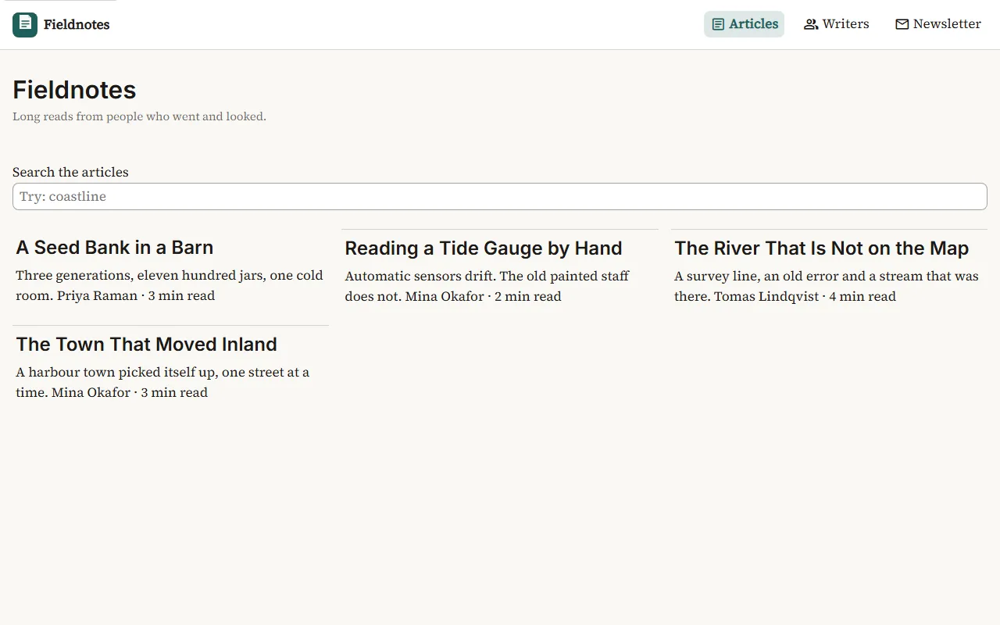](blog-cms) | [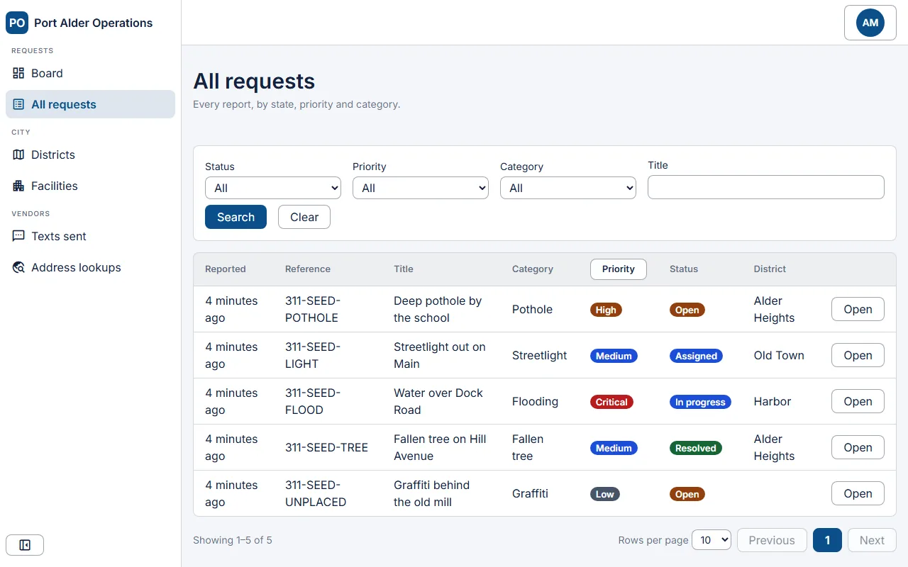](city-services) | [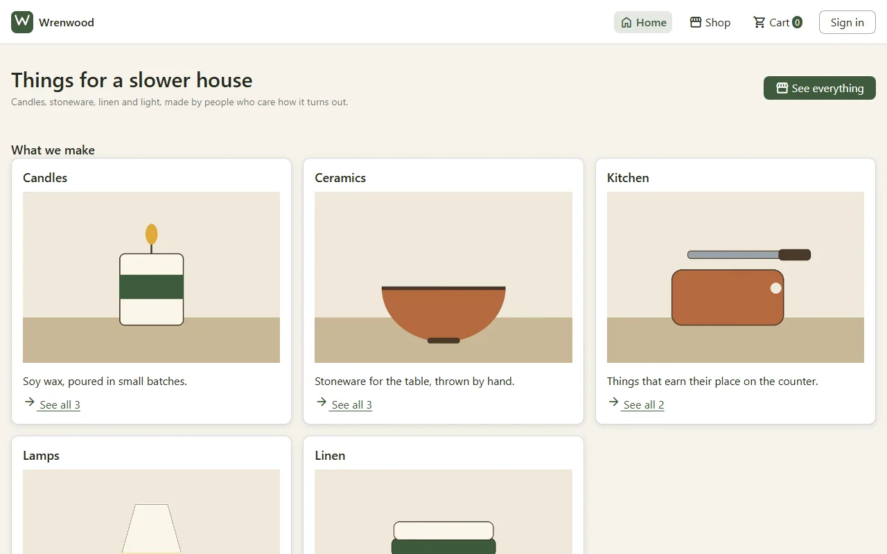](ecommerce) |
| **Fieldnotes**, a publication | **Port Alder 311**, a city service desk | **Wrenwood**, a homeware shop |
| [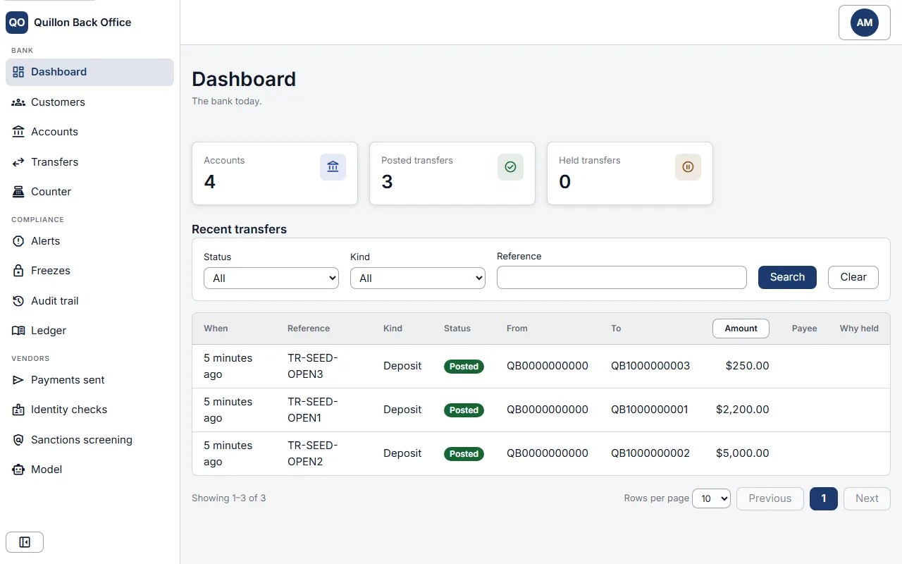](finance) | [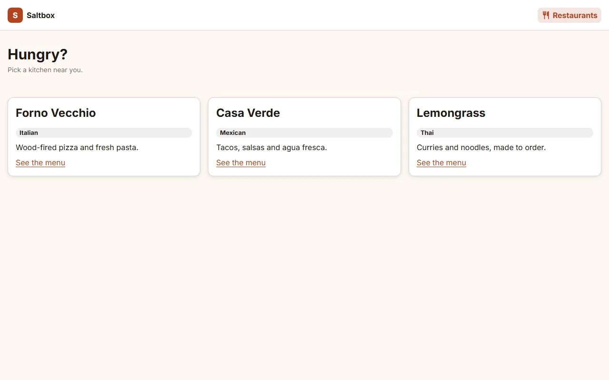](food-delivery) | [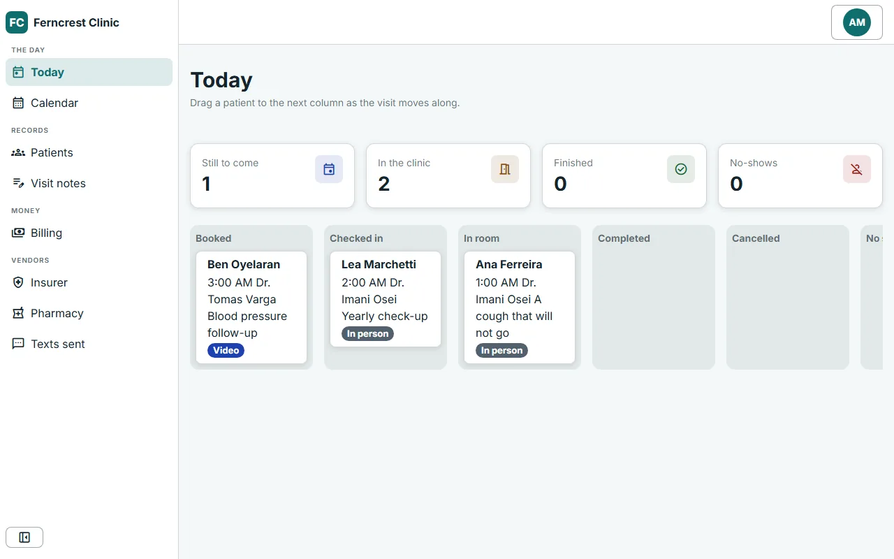](healthcare) |
| **Quillon Bank**, a retail bank | **Saltbox**, food delivery | **Ferncrest Clinic**, a clinic |
| [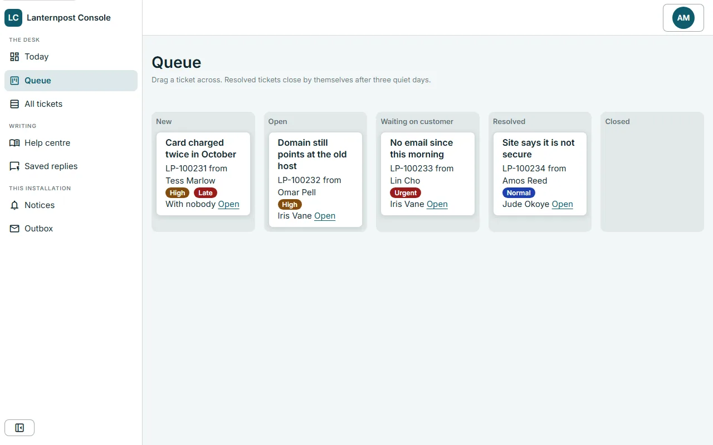](helpdesk) | [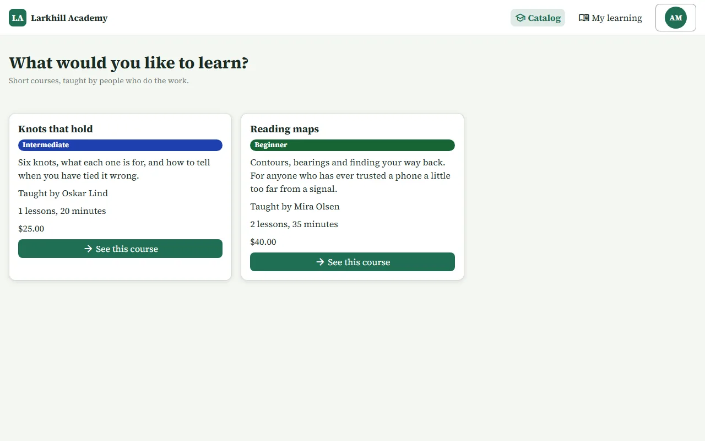](learning-management) | [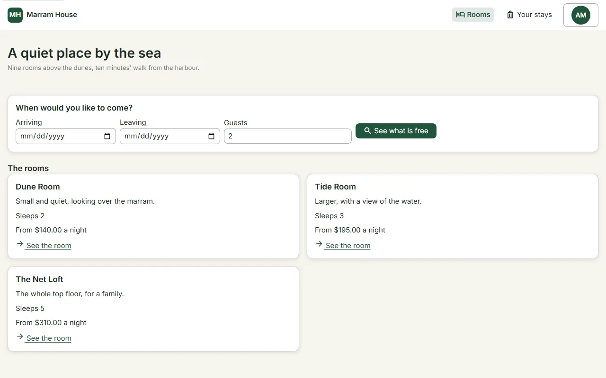](hotel-booking) |
| **Lanternpost**, a support desk | **Larkhill Academy**, courses | **Marram House**, a coastal hotel |
| [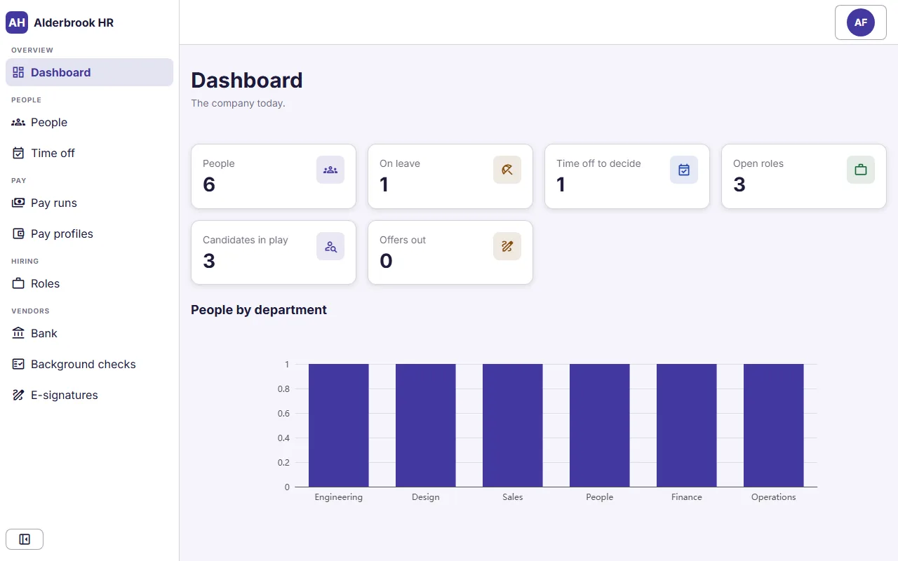](hr-platform) | [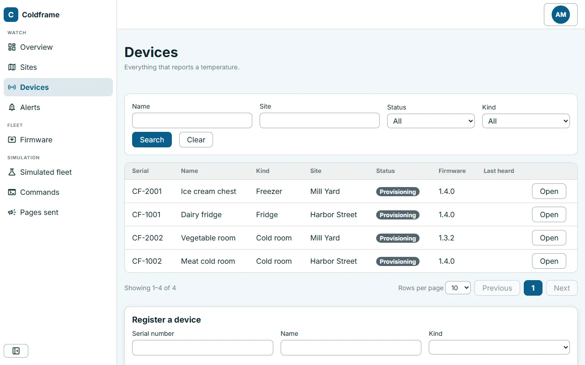](iot-platform) | [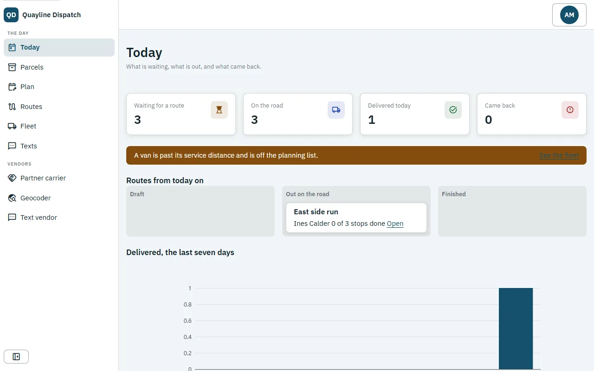](logistics) |
| **Alderbrook People**, HR | **Coldframe**, cold-storage monitoring | **Quayline Freight**, a parcel carrier |
| [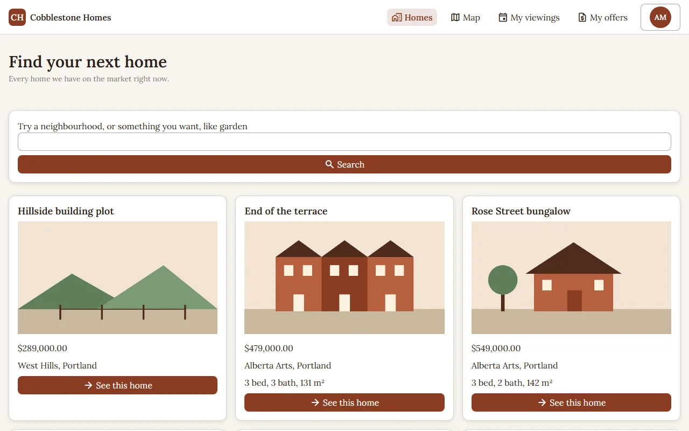](real-estate) | [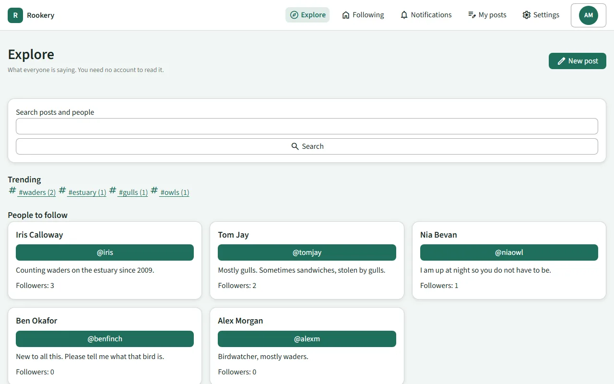](social-platform) | [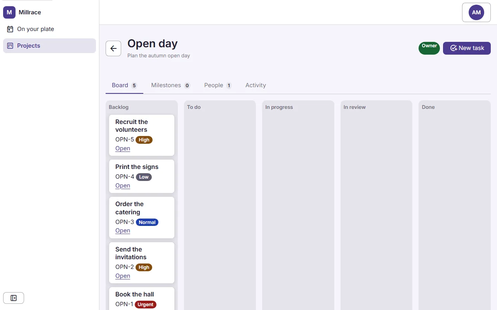](task-management) |
| **Cobblestone Homes**, real estate | **Rookery**, short posts | **Millrace**, team projects |

|  |  |
|---|---|
| Applications | 15, from a blog to a bank, each with its own invented company, data and vendors |
| Backend languages | Python (FastAPI) for 8, TypeScript (NestJS) for 7, from the same kind of spec |
| Clients | Angular web apps, and Flutter apps for phones |
| Local run | Docker Compose, with sign-in, mock vendors and seed data included |
| Cloud | AWS (CloudFormation) for 7, Azure (Bicep) for 8 |

## The applications

Every application is invented, runs entirely against mocks of its outside vendors, and needs no account with anyone. Each folder has its own `README.md` listing the features it shows, the parts and ports, and things to try.

| Application | Folder | What it is | Backend | Cloud |
|---|---|---|---|---|
| Fieldnotes | [blog-cms](blog-cms) | A publication: public reader site, writers' studio, scheduled publishing, moderated comments, a newsletter | Python | Azure |
| Port Alder 311 | [city-services](city-services) | A city service desk: residents report problems from an address, staff work the queue, spatial answers from PostGIS | Python | AWS |
| Wrenwood | [ecommerce](ecommerce) | A homeware shop: browse without an account, cart, payment, parcel tracking, staff catalog and refunds, two languages | Python | Azure |
| Quillon Bank | [finance](finance) | A retail bank on a double-entry ledger, with an AI analyst that proposes freezes a second officer must approve | Python | AWS |
| Saltbox | [food-delivery](food-delivery) | Food delivery for customers, kitchens and drivers | Python | Azure |
| Ferncrest Clinic | [healthcare](healthcare) | A clinic: booking, front-desk board, signed notes and prescriptions, insurer claims | Python | AWS |
| Lanternpost | [helpdesk](helpdesk) | A support desk: help centre, tickets, agent board, private notes, a clock a job watches | Python | Azure |
| Larkhill Academy | [learning-management](learning-management) | Courses, payment, lessons with questions, a tutor, certificates and refunds | Python | Azure |
| Marram House | [hotel-booking](hotel-booking) | A coastal hotel: date search, a ten-minute room hold, front-desk arrivals and housekeeping | TypeScript | AWS |
| Alderbrook People | [hr-platform](hr-platform) | Hiring through signed offer to employee, time off, payslips, payroll approved by two people | TypeScript | Azure |
| Coldframe | [iot-platform](iot-platform) | Cold-storage monitoring: readings, alerts, technicians, staged firmware rollouts | TypeScript | AWS |
| Quayline Freight | [logistics](logistics) | A parcel carrier: booking, route planning, a driver app, public tracking, partner hand-off | TypeScript | AWS |
| Cobblestone Homes | [real-estate](real-estate) | Home search, viewings, offers with lender pre-approval, contracts for signature | TypeScript | Azure |
| Rookery | [social-platform](social-platform) | Short posts and following, every post moderated, a trust-and-safety desk | TypeScript | AWS |
| Millrace | [task-management](task-management) | Team projects on a board, blocked tasks, chat and email notices | TypeScript | Azure |

## Layout

```
cruftfree-examples/
├── <domain>/                              the specification
│   ├── system.cfree, *-service.cfree, *-app.cfree, ui.cfree   services, apps, theme
│   ├── providers/, mocks/                 outside vendors as contracts, and their mocks
│   ├── config/                            .ccfg profiles: test, development, production
│   ├── seed/, assets/                     first-start data, fonts and images
│   └── README.md                          what it shows, the parts, things to try
├── <domain>-generated/
│   ├── docker-<language>/                 generated from the `test` profile: a local Compose stack
│   └── aws-<language>/ or azure-<language>/   generated from the `development` profile: cloud infrastructure
└── scripts/git/                           commit-and-push and pull for this repository
```

`<language>` is `python` or `typescript`. The cloud and the language of each application are in the table above.

### What a generated tree holds

- One service folder per backend service, and one per mock vendor, each with its API, persistence, tests and `Dockerfile`.
- `clients/angular` and `clients/flutter`: the web apps and the phone app.
- In `docker-*`: `docker-compose.yml` with PostgreSQL, Kafka, the Zitadel identity server, and Prometheus, Grafana, Loki, Jaeger and Alertmanager for observability (plus Redis where an application uses it); `scripts/deploy.*`; `ENV.md`.
- In `aws-*`: `infrastructure/` (CloudFormation templates), deploy scripts and `DEPLOYMENT.md`.
- In `azure-*`: `infra/` (Bicep), `DEPLOYMENT.md` and an Azure DevOps pipeline.
- `docs/`, `tests/` and `config/` in every tree.

## Generate it yourself

Install CruftFree from [cruftfree.dev](https://cruftfree.dev), then from the root of this repository:

```bash
# the local Docker stack (the `test` profile)
cruftfree generate -s blog-cms/system.cfree -L python --profile test -o out/blog-cms-docker

# the cloud infrastructure (the `development` profile)
cruftfree generate -s blog-cms/system.cfree -L python --profile development -o out/blog-cms-azure
```

`-L typescript` generates the same kind of project in TypeScript for the seven applications that use it. Use the language and profile the table and layout above show for the one you pick.

## Run a stack locally

Docker with Compose is the only requirement. The generated deploy script needs a `.env`, which it expects to copy from a `.env.example` that every generation writes with fresh random passwords. Those files are not in this repository, so generate the tree as above, then:

```bash
cd out/blog-cms-docker
cp .env.example .env
./scripts/deploy.sh        # Windows: scripts\deploy.ps1
```

Each application's own README names the ports it opens and what to try first. Sign-in runs on the Zitadel in the stack; the application README says which user to register and which roles to grant. Only one application can hold the default ports at a time, and `.env` moves them. `scripts/deploy.* down` stops a stack and keeps its data.

## What has been verified

All fifteen `test` stacks were built and run locally with Docker, and every page of each was opened signed in without console errors or failed requests. The `development` outputs for AWS and Azure are generated and compile (CloudFormation and Bicep), but they have not been deployed to a cloud account.

## Scripts

[`scripts/git/`](scripts/git) holds `commit-and-push` and `pull` for this repository, in PowerShell and shell. They refuse to commit secrets, environment files, personal data or machine-local files, and write commit messages with a local model, falling back to Claude. See [scripts/git/README.md](scripts/git/README.md) for the first-time setup.

## License

Apache License 2.0, see [LICENSE](LICENSE).
