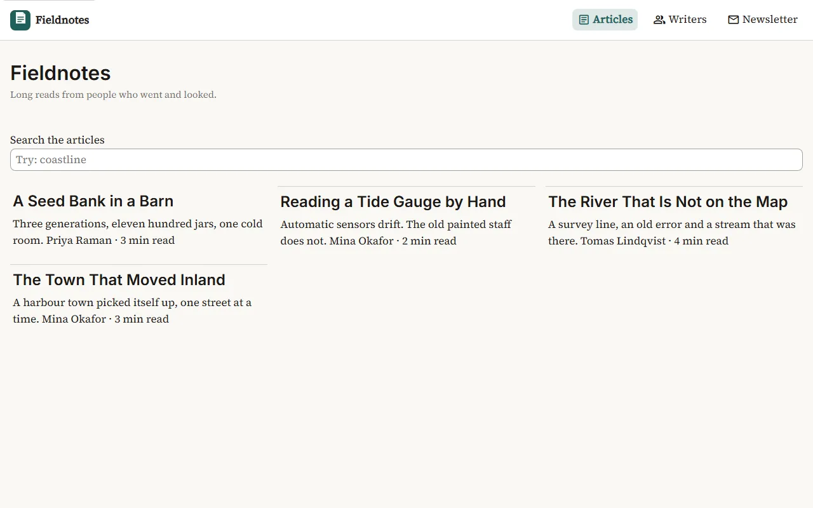
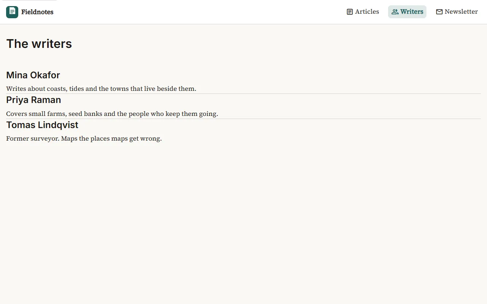
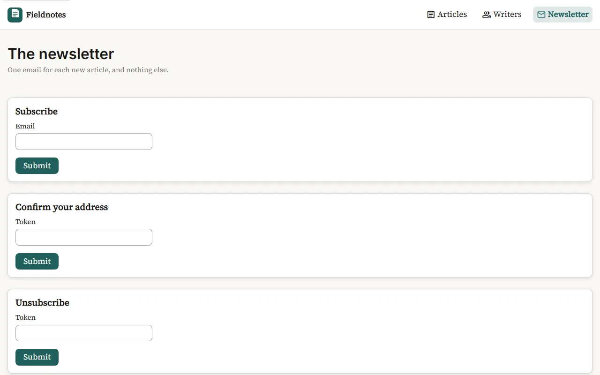
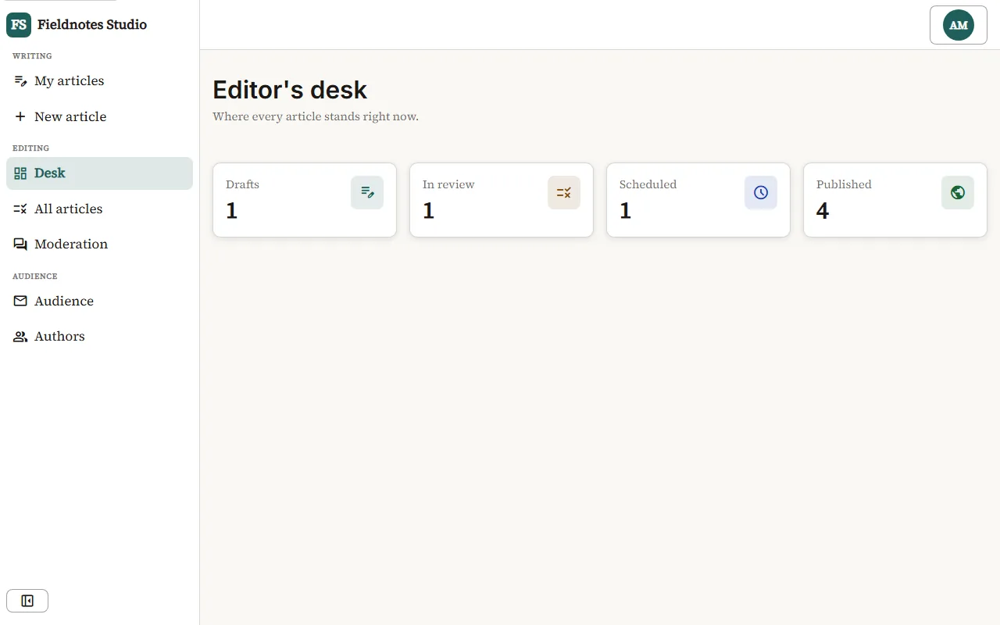
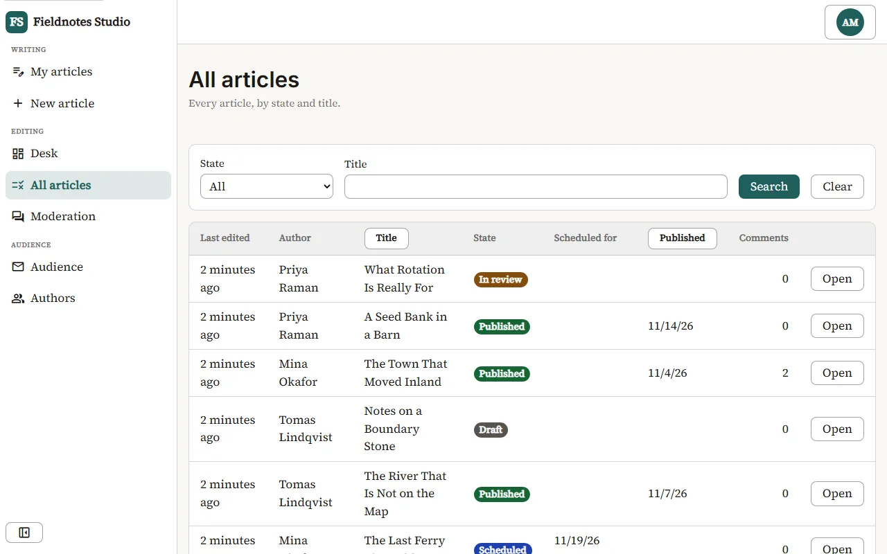
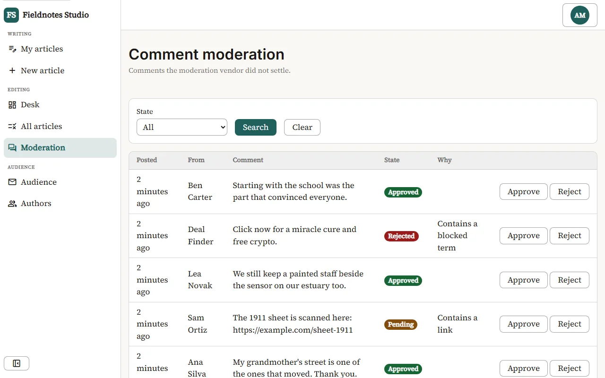
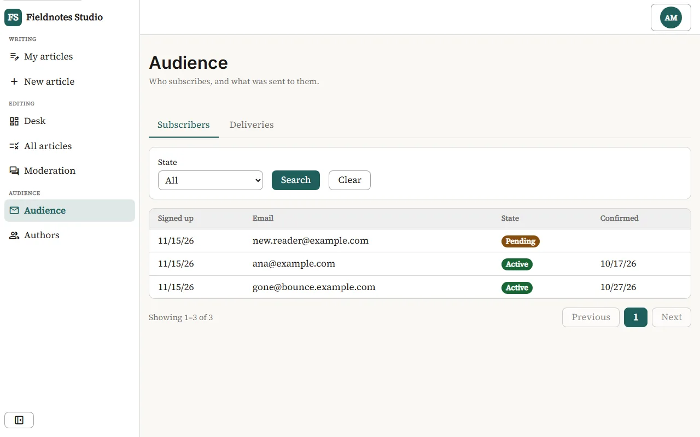
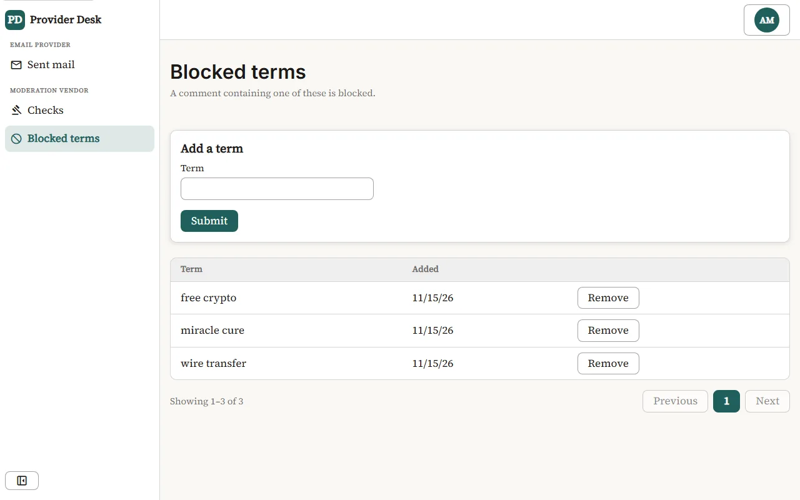

# Fieldnotes

A small publication, built as a complete application: a public site readers use on the web and on a phone, a studio where writers and editors work, and two outside vendors running as mocks in the same stack. Nothing here needs an account with anyone.

<!-- screenshots:start (written by scripts/screenshots; edit screenshots.json instead) -->
## Screenshots

|  |  |
|---|---|
| Reader: the articles, with search | Reader: the writers |

|  |  |
|---|---|
| Reader: subscribing to the newsletter | Studio: the editors' desk |

|  |  |
|---|---|
| Studio: every article and where it stands | Studio: comment moderation |

|  |  |
|---|---|
| Studio: the newsletter audience | Provider Desk: the moderation vendor's blocked terms |
<!-- screenshots:end -->

## What it shows

| Feature | Where |
|---|---|
| A public site with no sign-in, on web and mobile, from one app definition | [reader-app.cfree](reader-app.cfree) |
| A staff app whose sign-in and roles follow from the routes each page reaches | [studio-app.cfree](studio-app.cfree) |
| An editorial workflow, with a job that publishes scheduled articles | [content-service.cfree](content-service.cfree) |
| A version history the database itself keeps append-only | `PostRevision` in [content-service.cfree](content-service.cfree) |
| Events between services through a transactional outbox | `PostPublished`, `CommentApproved`, `AuthorStatusChanged` |
| Third parties behind `extern service` contracts | [providers/](providers/) |
| Mock vendors that authenticate callers with API keys, storing only hashes | [mocks/](mocks/), [config/identity/mail-keys.ccfg](config/identity/mail-keys.ccfg) |
| A failure that stays safe: no moderation answer means the comment waits | `moderate` in [comment-service.cfree](comment-service.cfree) |
| Delivery that is safe to retry: one key per message and subscriber | `sendDelivery` in [newsletter-service.cfree](newsletter-service.cfree) |
| Realistic data on first start, with dates relative to the seed run | [seed/](seed/) |

## The parts

| Part | Port | What it does |
|---|---|---|
| Reader app | 4200 | Articles, search, comments, the newsletter |
| Studio app | 4300 | Writing, the review queue, moderation, the audience |
| Provider Desk app | 4400 | Every email sent and every moderation verdict, plus the blocked terms |
| `AuthorService` | 8001 | Writer profiles, and the application's identity block |
| `ContentService` | 8002 | Articles and the publishing workflow |
| `CommentService` | 8003 | Comments, checked by the moderation vendor |
| `NewsletterService` | 8004 | Subscriptions and delivery through the email provider |
| `MailMock` | 8090 | Stands in for the email provider |
| `ModerationMock` | 8091 | Stands in for the moderation vendor |

## Third parties

The product services call a contract and do not know a mock answers it. To use a real vendor, point the URL in [config/providers/](config/providers/) at it and supply the secret. No `.cfree` file changes.

| Contract | Mock | What the mock does |
|---|---|---|
| `MailProvider` | `MailMock` | Keeps every message in an inbox. An address ending `@bounce.example.com` bounces |
| `ModerationProvider` | `ModerationMock` | A blocked term is blocked, a link goes to review, anything else is allowed |

## Run it

```bash
cruftfree generate -s examples/03-domains/blog-cms/system.cfree -L python
cd <the generated output>
cp .env.example .env
./scripts/deploy.sh        # Windows: scripts\deploy.ps1
```

TypeScript generates from the same source with `-L typescript`. Only one example can hold the default ports at a time, and `.env` moves them.

Then open:

- Reader: <http://localhost:4200>
- Studio: <http://localhost:4300>
- Provider Desk: <http://localhost:4400>

## Things to try

1. **See moderation decide.** Open an article in the Reader and post a comment. Plain text appears straight away. A comment with a link waits for an editor. One containing `miracle cure` is rejected. Each verdict shows in the Provider Desk under Checks.
2. **Follow an email.** Subscribe on the Newsletter page, find the confirmation code in the Provider Desk under Sent mail, and enter it.
3. **Publish an article.** Register in the Studio, write a draft and send it to review. With the `editor` role, publish it. The next run of the delivery job sends one email per confirmed subscriber, and the seeded address on the bounce domain shows a bounce.

## Sign-in and roles

Sign-in runs on the Zitadel in the stack, so nothing here handles a password. Anyone can register in the Studio and write. `editor`, `admin` and `operator` are granted, never self-assigned: sign in to the Zitadel console at <http://localhost:8085/ui/console> as the admin named in `.env`, then grant the role on the `fieldnotes-identity` project.

The Provider Desk needs `operator`. The Reader needs no account.

## The development keys

`config/*-service.ccfg` carries a `localDefault` for each vendor key, named `dev-only-…-not-a-credential`, and `seed/` holds its SHA-256 hash. Both only let this stack's services reach this stack's mocks. Any other deployment has to supply its own value.

Every person, address and article in the seed data is invented, and every address is on the reserved `example.com` domain.
