# Diagrams

Drawn from this application's `.cfree` specification by CruftFree's `visualize` script. They are generated files: change the specification and run the script again rather than editing them.

## System context

Who uses the system, the services they reach, and the external systems behind them.

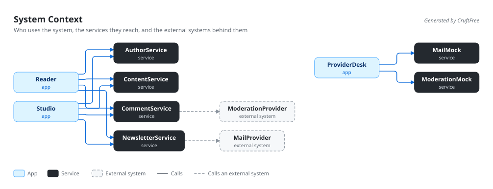

## Service map

Services, the calls between them, and the infrastructure they share.

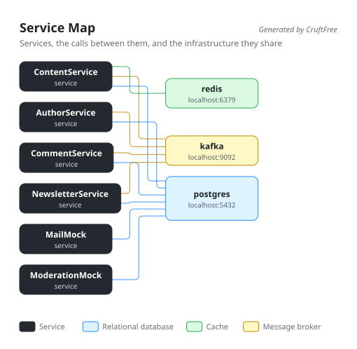

## Event flow

Events each service publishes, and the services that handle them.

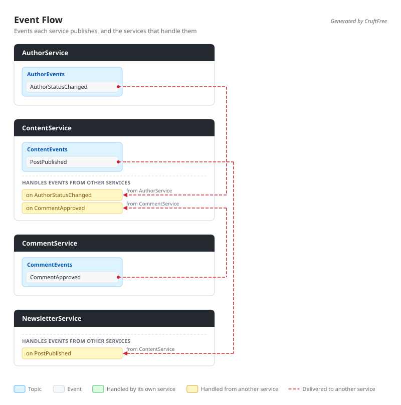

## Infrastructure by service

The databases, caches, brokers, storage and jobs each service declares.

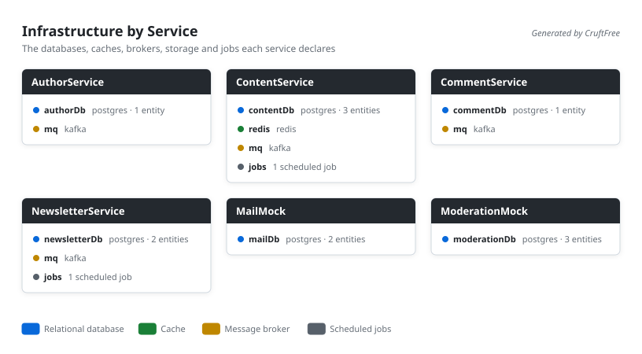

## Data models

One entity-relationship diagram per service: entities, keys and relationships.

### AuthorService

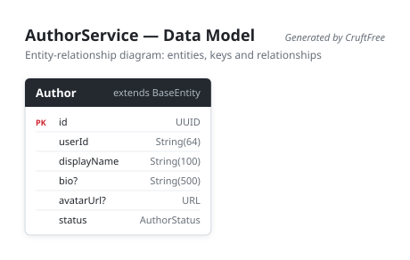

### CommentService

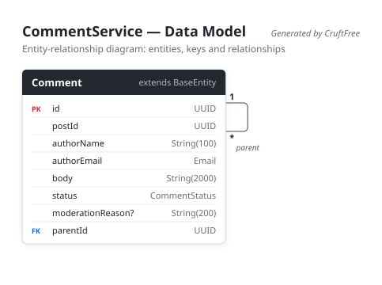

### ContentService

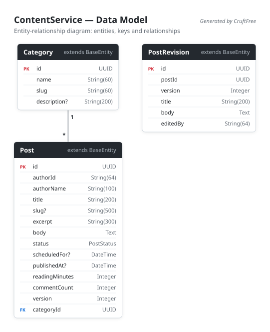

### MailMock

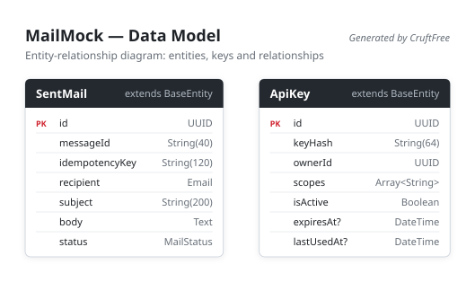

### ModerationMock

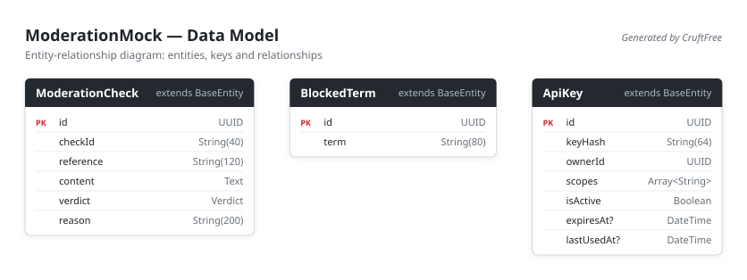

### NewsletterService

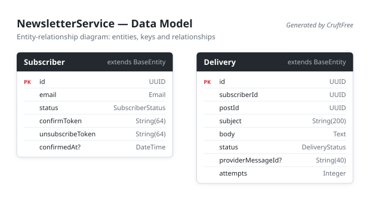

## Entity inheritance

One diagram per service: the abstract entities each entity extends, and the traits it uses.

### AuthorService

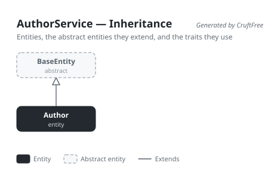

### CommentService

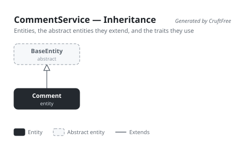

### ContentService

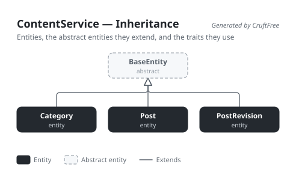

### MailMock

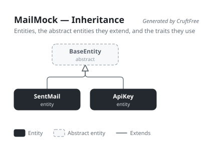

### ModerationMock

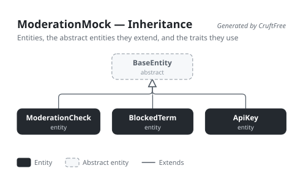

### NewsletterService

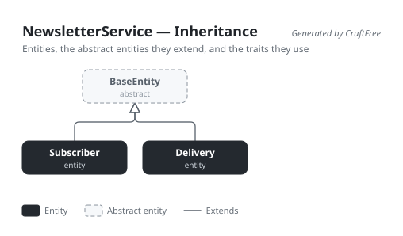

## API catalog

Every REST endpoint of every service.

See [api-catalog.md](api-catalog.md).
