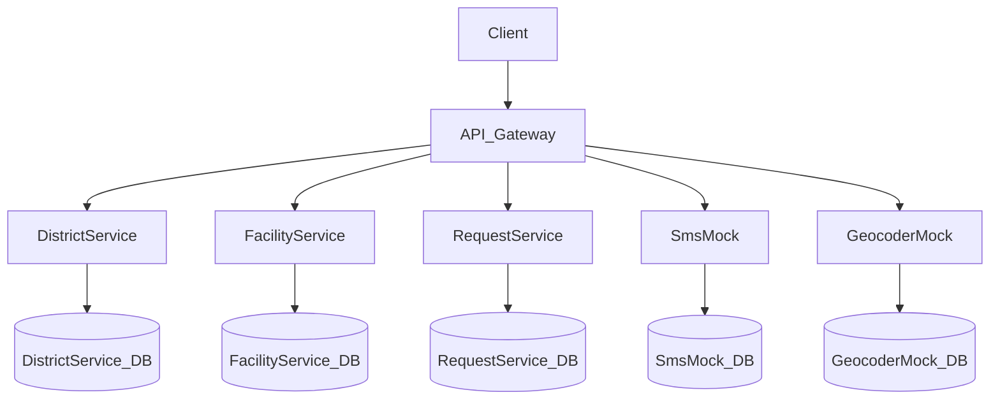

# Architecture

## Overview

cityservices is a microservice-based application built with FastAPI and Python 3.11+.

## System Overview

| Property | Value |
|----------|-------|
| Services | 5 |
| Entities | 11 |
| Database | PostgreSQL (async) |
| Framework | FastAPI |
| Language | Python 3.11+ |
| Architecture | Clean Architecture |
| Deployment | docker-compose |

## Architecture Diagram



## Services

### DistrictService

- **Port:** 8001
- **Directory:** `cityservices_district_service/`
- **Entities:** District, ZoningArea
- **REST API:** Yes

### FacilityService

- **Port:** 8002
- **Directory:** `cityservices_facility_service/`
- **Entities:** Facility, Park
- **REST API:** Yes

### RequestService

- **Port:** 8003
- **Directory:** `cityservices_request_service/`
- **Entities:** RequestUpdate, ServiceRequest
- **REST API:** Yes

### SmsMock

- **Port:** 8090
- **Directory:** `cityservices_sms_mock/`
- **Entities:** ApiKey, SentSms
- **REST API:** Yes

### GeocoderMock

- **Port:** 8091
- **Directory:** `cityservices_geocoder_mock/`
- **Entities:** ApiKey, KnownAddress, Lookup
- **REST API:** Yes


## Database Schema

### Entity Relationships

```mermaid
erDiagram
    District {

        DateTime createdAt
        DateTime updatedAt
        UUID id PK
        String(200) name
        String(20) code
        Integer population
        Text boundaryGeoJson
        Geometry? boundary
        Text? description
    }

    ZoningArea {

        DateTime createdAt
        DateTime updatedAt
        UUID id PK
        String(200) name
        String(20) zoneCode
        ZoningType type
        Text boundaryGeoJson
        Geometry? boundary
        UUID districtId
    }

    Facility {

        DateTime createdAt
        DateTime updatedAt
        UUID id PK
        String(200) name
        FacilityType type
        Float latitude
        Float longitude
        Geometry? location
        String(300) address
        Phone phone
        Boolean isOperational
    }

    Park {

        DateTime createdAt
        DateTime updatedAt
        UUID id PK
        String(200) name
        Text boundaryGeoJson
        Geometry? boundary
        Boolean isOpen
        Text? amenities
    }

    ServiceRequest {

        DateTime createdAt
        DateTime updatedAt
        UUID id PK
        String(30) requestNumber
        String(200) title
        Text description
        RequestCategory category
        RequestPriority priority
        RequestStatus status
        String(300) address
        Float? latitude
        Float? longitude
        Geometry? location
        UUID? districtId
        String(200)? districtName
        Phone? reporterPhone
    }

    RequestUpdate {

        DateTime createdAt
        DateTime updatedAt
        UUID id PK
        UUID requestId
        RequestStatus status
        String(500) note
    }

    SentSms {

        DateTime createdAt
        DateTime updatedAt
        UUID id PK
        String(40) messageId
        String(120) idempotencyKey
        Phone recipient
        String(320) body
        TextStatus status
    }

    ApiKey {

        DateTime createdAt
        DateTime updatedAt
        UUID id PK
        String(64) keyHash
        UUID ownerId
        Array<String> scopes
        Boolean isActive
        DateTime? expiresAt
        DateTime? lastUsedAt
    }

    KnownAddress {

        DateTime createdAt
        DateTime updatedAt
        UUID id PK
        String(300) address
        String(300) formattedAddress
        Float latitude
        Float longitude
    }

    Lookup {

        DateTime createdAt
        DateTime updatedAt
        UUID id PK
        String(300) query
        Boolean matched
    }

    ApiKey {

        DateTime createdAt
        DateTime updatedAt
        UUID id PK
        String(64) keyHash
        UUID ownerId
        Array<String> scopes
        Boolean isActive
        DateTime? expiresAt
        DateTime? lastUsedAt
    }

    ZoningArea }o--|| District : "belongsTo"

```

### Entity Details

#### District

| Field | Type | Optional | Description |
|-------|------|----------|-------------|
| `createdAt` | DateTime | No | Createdat |
| `updatedAt` | DateTime | No | Updatedat |
| `id` | UUID | No | Id |
| `name` | String(200) | No | Name |
| `code` | String(20) | No | Code |
| `population` | Integer | No | Population |
| `boundaryGeoJson` | Text | No | Boundarygeojson |
| `boundary` | Geometry? | Yes | Boundary |
| `description` | Text? | Yes | Description |

#### ZoningArea

| Field | Type | Optional | Description |
|-------|------|----------|-------------|
| `createdAt` | DateTime | No | Createdat |
| `updatedAt` | DateTime | No | Updatedat |
| `id` | UUID | No | Id |
| `name` | String(200) | No | Name |
| `zoneCode` | String(20) | No | Zonecode |
| `type` | ZoningType | No | Type |
| `boundaryGeoJson` | Text | No | Boundarygeojson |
| `boundary` | Geometry? | Yes | Boundary |
| `districtId` | UUID | No | Districtid |

#### Facility

| Field | Type | Optional | Description |
|-------|------|----------|-------------|
| `createdAt` | DateTime | No | Createdat |
| `updatedAt` | DateTime | No | Updatedat |
| `id` | UUID | No | Id |
| `name` | String(200) | No | Name |
| `type` | FacilityType | No | Type |
| `latitude` | Float | No | Latitude |
| `longitude` | Float | No | Longitude |
| `location` | Geometry? | Yes | Location |
| `address` | String(300) | No | Address |
| `phone` | Phone | No | Phone |
| `isOperational` | Boolean | No | Isoperational |

#### Park

| Field | Type | Optional | Description |
|-------|------|----------|-------------|
| `createdAt` | DateTime | No | Createdat |
| `updatedAt` | DateTime | No | Updatedat |
| `id` | UUID | No | Id |
| `name` | String(200) | No | Name |
| `boundaryGeoJson` | Text | No | Boundarygeojson |
| `boundary` | Geometry? | Yes | Boundary |
| `isOpen` | Boolean | No | Isopen |
| `amenities` | Text? | Yes | Amenities |

#### ServiceRequest

| Field | Type | Optional | Description |
|-------|------|----------|-------------|
| `createdAt` | DateTime | No | Createdat |
| `updatedAt` | DateTime | No | Updatedat |
| `id` | UUID | No | Id |
| `requestNumber` | String(30) | No | Requestnumber |
| `title` | String(200) | No | Title |
| `description` | Text | No | Description |
| `category` | RequestCategory | No | Category |
| `priority` | RequestPriority | No | Priority |
| `status` | RequestStatus | No | Status |
| `address` | String(300) | No | Address |
| `latitude` | Float? | Yes | Latitude |
| `longitude` | Float? | Yes | Longitude |
| `location` | Geometry? | Yes | Location |
| `districtId` | UUID? | Yes | Districtid |
| `districtName` | String(200)? | Yes | Districtname |
| `reporterPhone` | Phone? | Yes | Reporterphone |

#### RequestUpdate

| Field | Type | Optional | Description |
|-------|------|----------|-------------|
| `createdAt` | DateTime | No | Createdat |
| `updatedAt` | DateTime | No | Updatedat |
| `id` | UUID | No | Id |
| `requestId` | UUID | No | Requestid |
| `status` | RequestStatus | No | Status |
| `note` | String(500) | No | Note |

#### SentSms

| Field | Type | Optional | Description |
|-------|------|----------|-------------|
| `createdAt` | DateTime | No | Createdat |
| `updatedAt` | DateTime | No | Updatedat |
| `id` | UUID | No | Id |
| `messageId` | String(40) | No | Messageid |
| `idempotencyKey` | String(120) | No | Idempotencykey |
| `recipient` | Phone | No | Recipient |
| `body` | String(320) | No | Body |
| `status` | TextStatus | No | Status |

#### ApiKey

| Field | Type | Optional | Description |
|-------|------|----------|-------------|
| `createdAt` | DateTime | No | Createdat |
| `updatedAt` | DateTime | No | Updatedat |
| `id` | UUID | No | Id |
| `keyHash` | String(64) | No | Keyhash |
| `ownerId` | UUID | No | Ownerid |
| `scopes` | Array<String> | No | Scopes |
| `isActive` | Boolean | No | Isactive |
| `expiresAt` | DateTime? | Yes | Expiresat |
| `lastUsedAt` | DateTime? | Yes | Lastusedat |

#### KnownAddress

| Field | Type | Optional | Description |
|-------|------|----------|-------------|
| `createdAt` | DateTime | No | Createdat |
| `updatedAt` | DateTime | No | Updatedat |
| `id` | UUID | No | Id |
| `address` | String(300) | No | Address |
| `formattedAddress` | String(300) | No | Formattedaddress |
| `latitude` | Float | No | Latitude |
| `longitude` | Float | No | Longitude |

#### Lookup

| Field | Type | Optional | Description |
|-------|------|----------|-------------|
| `createdAt` | DateTime | No | Createdat |
| `updatedAt` | DateTime | No | Updatedat |
| `id` | UUID | No | Id |
| `query` | String(300) | No | Query |
| `matched` | Boolean | No | Matched |

#### ApiKey

| Field | Type | Optional | Description |
|-------|------|----------|-------------|
| `createdAt` | DateTime | No | Createdat |
| `updatedAt` | DateTime | No | Updatedat |
| `id` | UUID | No | Id |
| `keyHash` | String(64) | No | Keyhash |
| `ownerId` | UUID | No | Ownerid |
| `scopes` | Array<String> | No | Scopes |
| `isActive` | Boolean | No | Isactive |
| `expiresAt` | DateTime? | Yes | Expiresat |
| `lastUsedAt` | DateTime? | Yes | Lastusedat |


## Infrastructure Components

| Component | Description |
|-----------|-------------|
| FastAPI | ASGI web framework with auto-generated OpenAPI docs |
| Structured Logging | JSON logging in production, console logging in development |
| Health Checks | `/health` endpoint with service status |
| Middleware | CORS, request logging, error handling |
| Prometheus Metrics | `/metrics` endpoint for scraping |
| OpenTelemetry | Distributed tracing with OTLP export |
| Message Queue | Async event-driven communication |


---

*Generated by cruftfree-codegen-python*
