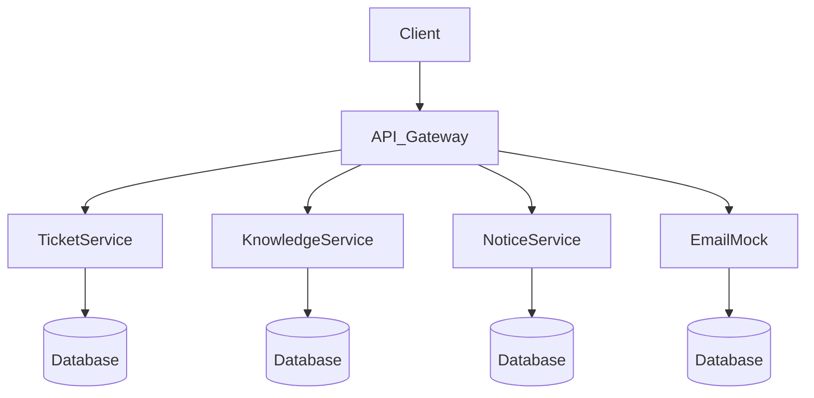

# helpdesk

Generated by [CruftFree](https://cruftfree.dev).

## Deploy to Azure

**Full step-by-step instructions are in [DEPLOYMENT.md](DEPLOYMENT.md)** — prerequisites
(including the required **Owner** / **User Access Administrator** role), manual `az`
deployment, and the Azure DevOps CI/CD setup.

Quick start (manual deploy of the infrastructure):

```bash
az login
az group create --name <resource-group> --location <region>

az bicep build --file infra/main.bicep              # readiness gate: must exit 0
az deployment group create \
    --resource-group <resource-group> \
    --parameters infra/main.bicepparam              # 'prod' -> infra/main.prod.bicepparam
```

Then deploy the application code — see [DEPLOYMENT.md](DEPLOYMENT.md).
CI/CD is in `azure-pipelines.yml`; secrets are read from Key Vault and never stored in the repo.

## Services

| Service | Port | Description |
|---------|------|-------------|
| TicketService | 8001 | FastAPI service (4 entities) |
| KnowledgeService | 8002 | FastAPI service (1 entities) |
| NoticeService | 8003 | FastAPI service (1 entities) |
| EmailMock | 8091 | FastAPI service (2 entities) |

## Development

```bash
# Run unit tests
python tests/unit_tests.py

# Run with coverage
python tests/unit_tests.py --coverage
```

## Architecture



## API Documentation

Each service exposes interactive API docs at:
- **TicketService**: deployed via Azure App Service (see `infra/main.bicep` for the URL)
- **KnowledgeService**: deployed via Azure App Service (see `infra/main.bicep` for the URL)
- **NoticeService**: deployed via Azure App Service (see `infra/main.bicep` for the URL)
- **EmailMock**: deployed via Azure App Service (see `infra/main.bicep` for the URL)


---

*Generated by cruftfree-codegen-python*
