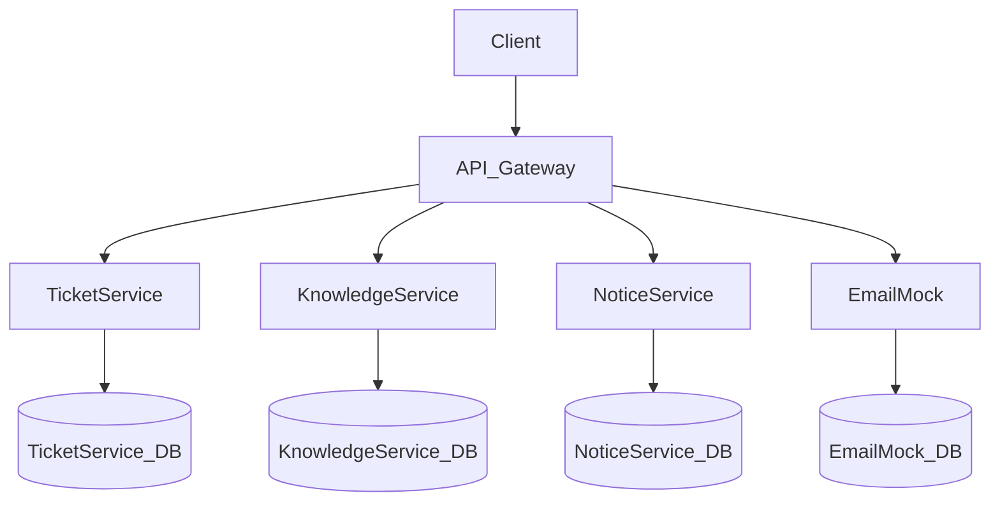

# Architecture

## Overview

helpdesk is a microservice-based application built with FastAPI and Python 3.11+.

## System Overview

| Property | Value |
|----------|-------|
| Services | 4 |
| Entities | 8 |
| Database | PostgreSQL (async) |
| Framework | FastAPI |
| Language | Python 3.11+ |
| Architecture | Clean Architecture |
| Deployment | Azure (azure-app-service-container) |

## Architecture Diagram



## Services

### TicketService

- **Port:** 8001
- **Directory:** `helpdesk_ticket_service/`
- **Entities:** ResponsePolicy, SavedReply, Ticket, TicketMessage
- **REST API:** Yes

### KnowledgeService

- **Port:** 8002
- **Directory:** `helpdesk_knowledge_service/`
- **Entities:** Article
- **REST API:** Yes

### NoticeService

- **Port:** 8003
- **Directory:** `helpdesk_notice_service/`
- **Entities:** Notice
- **REST API:** Yes

### EmailMock

- **Port:** 8091
- **Directory:** `helpdesk_email_mock/`
- **Entities:** ApiKey, Outbound
- **REST API:** Yes


## Azure Topology

This application is deployed to Azure. The realized topology includes:

| Component | Description |
|-----------|-------------|
| Azure App Service | Hosts each FastAPI service as a managed PaaS application |
| Azure Database for PostgreSQL | Fully managed Flexible Server for relational data |
| Azure Key Vault | Stores and rotates application secrets (connection strings, API keys) |
| Azure App Configuration | Centralised feature flags and non-secret configuration |
| Azure Event Hubs | Kafka-compatible event streaming for async service communication |
| Azure Front Door | Global HTTP load balancer and WAF at the public edge |
| Azure Virtual Network | Private networking between App Services, database, and Event Hubs |

Infrastructure is defined as Bicep in `infra/main.bicep` with parameters in
`infra/main.bicepparam`. Continuous delivery runs via `azure-pipelines.yml`.


## Database Schema

### Entity Relationships

```mermaid
erDiagram
    Ticket {

        DateTime createdAt
        DateTime updatedAt
        UUID id PK
        String(20) number
        String(200) subject
        TicketTopic topic
        Priority priority
        TicketStatus status
        String(64) customerId
        String(200) customerName
        Email customerEmail
        String(64)? assigneeId
        String(200)? assigneeName
        DateTime respondBy
        DateTime? firstRepliedAt
        DateTime? resolvedAt
        Boolean breached
        Integer? satisfaction
    }

    TicketMessage {

        DateTime createdAt
        DateTime updatedAt
        UUID id PK
        UUID ticketId
        String(200) authorName
        Boolean fromCustomer
        Boolean internal
        Text body
    }

    ResponsePolicy {

        DateTime createdAt
        DateTime updatedAt
        UUID id PK
        Priority priority
        Integer minutes
    }

    SavedReply {

        DateTime createdAt
        DateTime updatedAt
        UUID id PK
        String(120) title
        Text body
    }

    Article {

        DateTime createdAt
        DateTime updatedAt
        UUID id PK
        String(160) title
        String(300) summary
        Text body
        TicketTopic topic
        Boolean published
        Integer helpful
        Integer notHelpful
    }

    Notice {

        DateTime createdAt
        DateTime updatedAt
        UUID id PK
        String(200) recipient
        String(200) subject
        String(2000) body
        Boolean delivered
        Integer attempts
        String(120) noticeKey
    }

    Outbound {

        DateTime createdAt
        DateTime updatedAt
        UUID id PK
        String(200) recipient
        String(200) subject
        String(2000) body
        DeliveryStatus status
        String(40) deliveryId
        String(120) idempotencyKey
    }

    ApiKey {

        DateTime createdAt
        DateTime updatedAt
        UUID id PK
        String(64) keyHash
        UUID ownerId
        Array<String> scopes
        Boolean isActive
        DateTime? expiresAt
        DateTime? lastUsedAt
    }

```

### Entity Details

#### Ticket

| Field | Type | Optional | Description |
|-------|------|----------|-------------|
| `createdAt` | DateTime | No | Createdat |
| `updatedAt` | DateTime | No | Updatedat |
| `id` | UUID | No | Id |
| `number` | String(20) | No | Number |
| `subject` | String(200) | No | Subject |
| `topic` | TicketTopic | No | Topic |
| `priority` | Priority | No | Priority |
| `status` | TicketStatus | No | Status |
| `customerId` | String(64) | No | Customerid |
| `customerName` | String(200) | No | Customername |
| `customerEmail` | Email | No | Customeremail |
| `assigneeId` | String(64)? | Yes | Assigneeid |
| `assigneeName` | String(200)? | Yes | Assigneename |
| `respondBy` | DateTime | No | Respondby |
| `firstRepliedAt` | DateTime? | Yes | Firstrepliedat |
| `resolvedAt` | DateTime? | Yes | Resolvedat |
| `breached` | Boolean | No | Breached |
| `satisfaction` | Integer? | Yes | Satisfaction |

#### TicketMessage

| Field | Type | Optional | Description |
|-------|------|----------|-------------|
| `createdAt` | DateTime | No | Createdat |
| `updatedAt` | DateTime | No | Updatedat |
| `id` | UUID | No | Id |
| `ticketId` | UUID | No | Ticketid |
| `authorName` | String(200) | No | Authorname |
| `fromCustomer` | Boolean | No | Fromcustomer |
| `internal` | Boolean | No | Internal |
| `body` | Text | No | Body |

#### ResponsePolicy

| Field | Type | Optional | Description |
|-------|------|----------|-------------|
| `createdAt` | DateTime | No | Createdat |
| `updatedAt` | DateTime | No | Updatedat |
| `id` | UUID | No | Id |
| `priority` | Priority | No | Priority |
| `minutes` | Integer | No | Minutes |

#### SavedReply

| Field | Type | Optional | Description |
|-------|------|----------|-------------|
| `createdAt` | DateTime | No | Createdat |
| `updatedAt` | DateTime | No | Updatedat |
| `id` | UUID | No | Id |
| `title` | String(120) | No | Title |
| `body` | Text | No | Body |

#### Article

| Field | Type | Optional | Description |
|-------|------|----------|-------------|
| `createdAt` | DateTime | No | Createdat |
| `updatedAt` | DateTime | No | Updatedat |
| `id` | UUID | No | Id |
| `title` | String(160) | No | Title |
| `summary` | String(300) | No | Summary |
| `body` | Text | No | Body |
| `topic` | TicketTopic | No | Topic |
| `published` | Boolean | No | Published |
| `helpful` | Integer | No | Helpful |
| `notHelpful` | Integer | No | Nothelpful |

#### Notice

| Field | Type | Optional | Description |
|-------|------|----------|-------------|
| `createdAt` | DateTime | No | Createdat |
| `updatedAt` | DateTime | No | Updatedat |
| `id` | UUID | No | Id |
| `recipient` | String(200) | No | Recipient |
| `subject` | String(200) | No | Subject |
| `body` | String(2000) | No | Body |
| `delivered` | Boolean | No | Delivered |
| `attempts` | Integer | No | Attempts |
| `noticeKey` | String(120) | No | Noticekey |

#### Outbound

| Field | Type | Optional | Description |
|-------|------|----------|-------------|
| `createdAt` | DateTime | No | Createdat |
| `updatedAt` | DateTime | No | Updatedat |
| `id` | UUID | No | Id |
| `recipient` | String(200) | No | Recipient |
| `subject` | String(200) | No | Subject |
| `body` | String(2000) | No | Body |
| `status` | DeliveryStatus | No | Status |
| `deliveryId` | String(40) | No | Deliveryid |
| `idempotencyKey` | String(120) | No | Idempotencykey |

#### ApiKey

| Field | Type | Optional | Description |
|-------|------|----------|-------------|
| `createdAt` | DateTime | No | Createdat |
| `updatedAt` | DateTime | No | Updatedat |
| `id` | UUID | No | Id |
| `keyHash` | String(64) | No | Keyhash |
| `ownerId` | UUID | No | Ownerid |
| `scopes` | Array<String> | No | Scopes |
| `isActive` | Boolean | No | Isactive |
| `expiresAt` | DateTime? | Yes | Expiresat |
| `lastUsedAt` | DateTime? | Yes | Lastusedat |


## Infrastructure Components

| Component | Description |
|-----------|-------------|
| FastAPI | ASGI web framework with auto-generated OpenAPI docs |
| Structured Logging | JSON logging in production, console logging in development |
| Health Checks | `/health` endpoint with service status |
| Middleware | CORS, request logging, error handling |
| Prometheus Metrics | `/metrics` endpoint for scraping |
| OpenTelemetry | Distributed tracing with OTLP export |
| Message Queue | Async event-driven communication |


---

*Generated by cruftfree-codegen-python*
