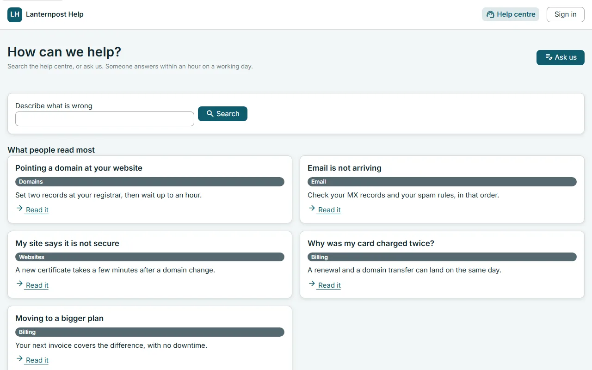
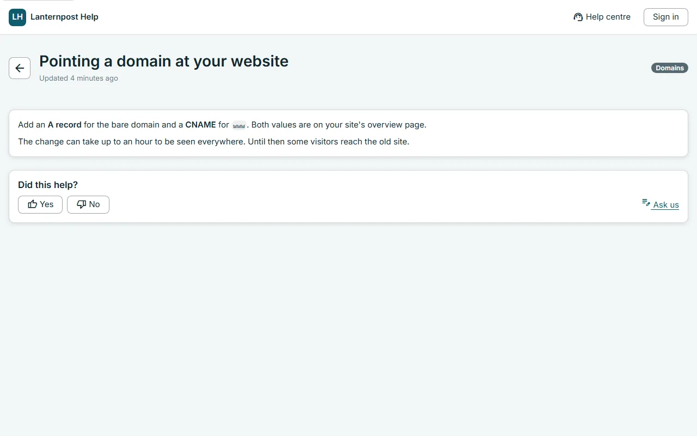
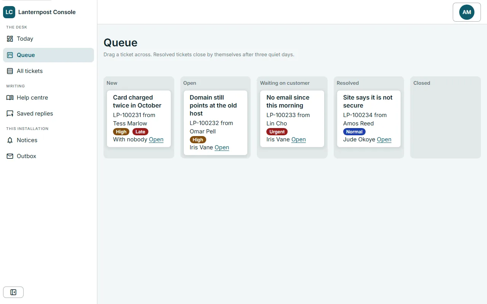
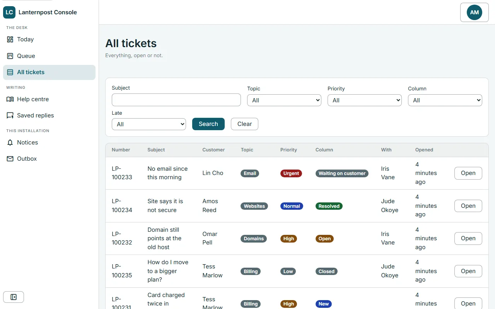
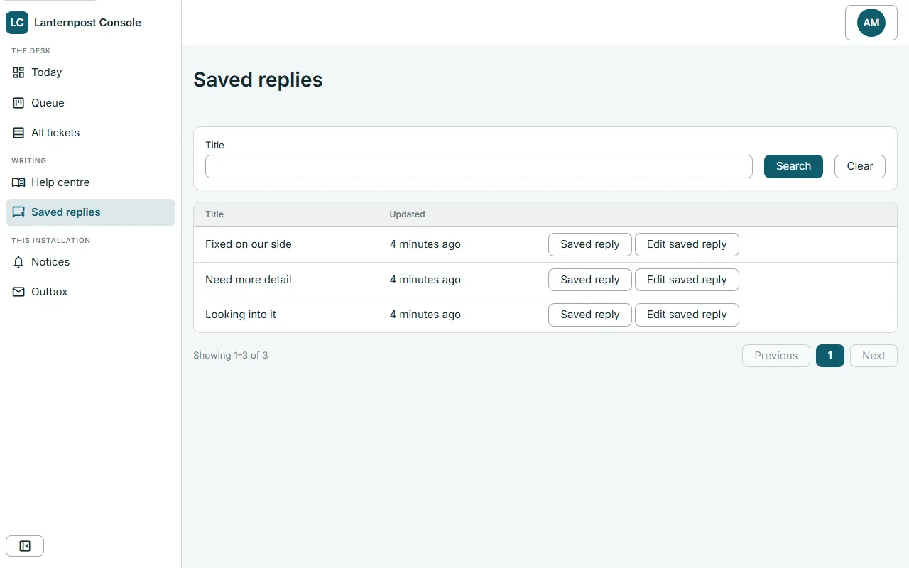

# Lanternpost

A support desk for a small hosting company, built as a complete application. Customers search a help centre and open tickets. Agents work them on a board, write notes the customer never sees, and answer against a clock that a job watches. The email vendor runs as a mock in the same stack, so nothing here needs an account with anyone. Lanternpost is invented.

<!-- screenshots:start (written by scripts/screenshots; edit screenshots.json instead) -->
## Screenshots

|  |  |
|---|---|
| Help centre: search and popular articles | Help centre: an article |

|  |  |
|---|---|
| Console: the agent's queue | Console: every ticket |

|  |   |
|---|---|
| Console: saved replies |   |
<!-- screenshots:end -->

## What it shows

| Feature | Where |
|---|---|
| Two audiences kept apart by their types: no customer struct has a field that could carry an internal note | `CustomerMessage` and `AgentMessage` in [ticket-service.cfree](ticket-service.cfree) |
| Data scoped to its owner: someone else's ticket reads as not found | `ownTicket` in [ticket-service.cfree](ticket-service.cfree) |
| A board you drag across, with the allowed moves kept on the server | `Queue` in [console-app.cfree](console-app.cfree), `move` in [ticket-service.cfree](ticket-service.cfree) |
| A response clock per priority, and a job that raises what runs out | `ResponsePolicy` and `WatchResponseClocks` in [ticket-service.cfree](ticket-service.cfree) |
| A job that ends a process: resolved tickets close after three quiet days | `CloseQuietTickets` in [ticket-service.cfree](ticket-service.cfree) |
| An append-only thread: what was said stays said | `TicketMessage` in [ticket-service.cfree](ticket-service.cfree) |
| An event turned into a stored notice, then a delivery, so a vendor being down loses nothing | `tell`, `deliver` and `RetryNotices` in [notice-service.cfree](notice-service.cfree) |
| Full-text search over published articles, with drafts unreachable | `search` and `publishedArticle` in [knowledge-service.cfree](knowledge-service.cfree) |
| A public page beside signed-in ones, with each page's guard derived from the routes it reaches | [help-app.cfree](help-app.cfree) |
| A dashboard with stats and a chart, built from routes written for it | `Dashboard` in [console-app.cfree](console-app.cfree) |
| Workspaces for what agents edit, with no id on any page | `Articles` and `SavedReplies` in [console-app.cfree](console-app.cfree) |
| A third party behind an `extern service` contract | [providers/](providers/) |
| A mock vendor that authenticates callers with API keys, storing only hashes | [mocks/](mocks/) |

## The parts

| Part | Port | What it does |
|---|---|---|
| Help app | 4200 | The help centre, and a customer's own tickets |
| Console app | 4300 | The dashboard, the queue, each ticket's thread, the help centre's articles and the saved replies |
| `TicketService` | 8001 | Tickets, threads, response clocks, and the application's identity block |
| `KnowledgeService` | 8002 | Articles, search and votes |
| `NoticeService` | 8003 | Turns events into emails |
| `EmailMock` | 8091 | Stands in for the email vendor |

## Third parties

`NoticeService` calls a contract and does not know a mock answers it. To use a real vendor, point the URL in [config/providers/email-provider.ccfg](config/providers/email-provider.ccfg) at it and supply the secret. No `.cfree` file changes.

| Contract | Mock | What the mock does |
|---|---|---|
| `EmailProvider` | `EmailMock` | Keeps every email in an outbox the Console shows. An address at `bounce.example.com` bounces |

## Run it

```bash
cruftfree generate -s examples/03-domains/helpdesk/system.cfree -L python
cd <the generated output>
cp .env.example .env
./scripts/deploy.sh        # Windows: scripts\deploy.ps1
```

TypeScript generates from the same source with `-L typescript`. Only one example can hold the default ports at a time, and `.env` moves them.

Then open:

- Help centre: <http://localhost:4200>
- Console: <http://localhost:4300>

## Things to try

1. **Find an answer.** Open the help centre signed out and search for `certificate`. The draft article about backups never appears, and its address reads as not found.
2. **Ask.** Sign up and choose **Ask us**. The ticket gets a number, and an email reaches the Console's Outbox a moment later, sent by an event.
3. **Take it.** In the Console, open the ticket from the queue and choose **Take it**. Add a note, then send one of the saved replies.
4. **Compare the two threads.** Back in the help centre, your ticket shows the answer and not the note.
5. **Watch the clock.** LP-100231 is seeded past its clock. Within a minute of the stack starting it is marked late, moved up to High, and the leads get an email.
6. **Try a move the desk refuses.** Drag a ticket straight to Closed. Only a resolved ticket can close.
7. **Say how it went.** Resolve your ticket, then score it in the help centre. The score reaches the Console's dashboard.

## Sign-in and roles

Sign-in runs on the Zitadel in the stack, so nothing here handles a password. Anyone can sign up as a customer. The Console needs `agent`, and its Notices and Outbox pages also need `operator`. Both are granted, never self-assigned: sign in to the Zitadel console at <http://localhost:8085/ui/console> as the admin named in `.env`, then grant the roles on the `lanternpost-identity` project.

## The development key

`config/notice-service.ccfg` carries a `localDefault` for the vendor key, named `dev-only-…-not-a-credential`, and `seed/email-mock.cseed` holds its SHA-256 hash. Both only let this stack's service reach this stack's mock. Any other deployment has to supply its own value.
