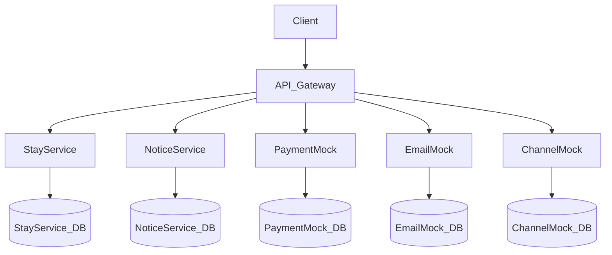

# Architecture

## Overview

hotel is a microservice-based application built with NestJS and TypeScript.

## System Overview

| Property | Value |
|----------|-------|
| Services | 5 |
| Entities | 10 |
| Database | PostgreSQL |
| Framework | NestJS |
| Language | TypeScript |
| Architecture | Modular Architecture |

## Architecture Diagram



## Services

### StayService

- **Port:** 8001
- **Directory:** `hotel_stay_service/`
- **Entities:** Room, RoomType, Stay
- **REST API:** Yes

### NoticeService

- **Port:** 8002
- **Directory:** `hotel_notice_service/`
- **Entities:** Notice
- **REST API:** Yes

### PaymentMock

- **Port:** 8090
- **Directory:** `hotel_payment_mock/`
- **Entities:** ApiKey, CardCharge
- **REST API:** Yes

### EmailMock

- **Port:** 8091
- **Directory:** `hotel_email_mock/`
- **Entities:** ApiKey, Outbound
- **REST API:** Yes

### ChannelMock

- **Port:** 8092
- **Directory:** `hotel_channel_mock/`
- **Entities:** ApiKey, PublishedNight
- **REST API:** Yes


## Database Schema

### Entity Relationships

```mermaid
erDiagram
    RoomType {

        DateTime createdAt
        DateTime updatedAt
        UUID id PK
        String(80) name
        String(200) summary
        Text description
        Integer sleeps
        Money nightlyRate
        Integer inventory
        Boolean listed
    }

    Room {

        DateTime createdAt
        DateTime updatedAt
        UUID id PK
        String(8) number
        UUID roomTypeId
        String(80) roomTypeName
        Integer floor
        RoomCondition condition
    }

    Stay {

        DateTime createdAt
        DateTime updatedAt
        UUID id PK
        String(20) code
        UUID roomTypeId
        String(80) roomTypeName
        String(8)? roomNumber
        String(64) guestId
        String(200) guestName
        Email guestEmail
        Date arrival
        Date departure
        Integer nights
        Integer guests
        Money total
        StayStatus status
        DateTime? holdUntil
        String(40)? chargeId
        Text? deskNote
    }

    Notice {

        DateTime createdAt
        DateTime updatedAt
        UUID id PK
        String(200) recipient
        String(200) subject
        String(2000) body
        Boolean delivered
        Integer attempts
        String(120) noticeKey
    }

    CardCharge {

        DateTime createdAt
        DateTime updatedAt
        UUID id PK
        String(80) reference
        Money amount
        String(3) currency
        ChargeStatus status
        String(200)? declineReason
        String(40) chargeId
        String(120) idempotencyKey
    }

    ApiKey {

        DateTime createdAt
        DateTime updatedAt
        UUID id PK
        String(64) keyHash
        UUID ownerId
        Array<String> scopes
        Boolean isActive
        DateTime? expiresAt
        DateTime? lastUsedAt
    }

    Outbound {

        DateTime createdAt
        DateTime updatedAt
        UUID id PK
        String(200) recipient
        String(200) subject
        String(2000) body
        DeliveryStatus status
        String(40) deliveryId
        String(120) idempotencyKey
    }

    ApiKey {

        DateTime createdAt
        DateTime updatedAt
        UUID id PK
        String(64) keyHash
        UUID ownerId
        Array<String> scopes
        Boolean isActive
        DateTime? expiresAt
        DateTime? lastUsedAt
    }

    PublishedNight {

        DateTime createdAt
        DateTime updatedAt
        UUID id PK
        String(80) roomType
        Date night
        Integer left
        Money nightlyRate
        DateTime receivedAt
    }

    ApiKey {

        DateTime createdAt
        DateTime updatedAt
        UUID id PK
        String(64) keyHash
        UUID ownerId
        Array<String> scopes
        Boolean isActive
        DateTime? expiresAt
        DateTime? lastUsedAt
    }

```

### Entity Details

#### RoomType

| Field | Type | Optional | Description |
|-------|------|----------|-------------|
| `createdAt` | DateTime | No | Createdat |
| `updatedAt` | DateTime | No | Updatedat |
| `id` | UUID | No | Id |
| `name` | String(80) | No | Name |
| `summary` | String(200) | No | Summary |
| `description` | Text | No | Description |
| `sleeps` | Integer | No | Sleeps |
| `nightlyRate` | Money | No | Nightlyrate |
| `inventory` | Integer | No | Inventory |
| `listed` | Boolean | No | Listed |

#### Room

| Field | Type | Optional | Description |
|-------|------|----------|-------------|
| `createdAt` | DateTime | No | Createdat |
| `updatedAt` | DateTime | No | Updatedat |
| `id` | UUID | No | Id |
| `number` | String(8) | No | Number |
| `roomTypeId` | UUID | No | Roomtypeid |
| `roomTypeName` | String(80) | No | Roomtypename |
| `floor` | Integer | No | Floor |
| `condition` | RoomCondition | No | Condition |

#### Stay

| Field | Type | Optional | Description |
|-------|------|----------|-------------|
| `createdAt` | DateTime | No | Createdat |
| `updatedAt` | DateTime | No | Updatedat |
| `id` | UUID | No | Id |
| `code` | String(20) | No | Code |
| `roomTypeId` | UUID | No | Roomtypeid |
| `roomTypeName` | String(80) | No | Roomtypename |
| `roomNumber` | String(8)? | Yes | Roomnumber |
| `guestId` | String(64) | No | Guestid |
| `guestName` | String(200) | No | Guestname |
| `guestEmail` | Email | No | Guestemail |
| `arrival` | Date | No | Arrival |
| `departure` | Date | No | Departure |
| `nights` | Integer | No | Nights |
| `guests` | Integer | No | Guests |
| `total` | Money | No | Total |
| `status` | StayStatus | No | Status |
| `holdUntil` | DateTime? | Yes | Holduntil |
| `chargeId` | String(40)? | Yes | Chargeid |
| `deskNote` | Text? | Yes | Desknote |

#### Notice

| Field | Type | Optional | Description |
|-------|------|----------|-------------|
| `createdAt` | DateTime | No | Createdat |
| `updatedAt` | DateTime | No | Updatedat |
| `id` | UUID | No | Id |
| `recipient` | String(200) | No | Recipient |
| `subject` | String(200) | No | Subject |
| `body` | String(2000) | No | Body |
| `delivered` | Boolean | No | Delivered |
| `attempts` | Integer | No | Attempts |
| `noticeKey` | String(120) | No | Noticekey |

#### CardCharge

| Field | Type | Optional | Description |
|-------|------|----------|-------------|
| `createdAt` | DateTime | No | Createdat |
| `updatedAt` | DateTime | No | Updatedat |
| `id` | UUID | No | Id |
| `reference` | String(80) | No | Reference |
| `amount` | Money | No | Amount |
| `currency` | String(3) | No | Currency |
| `status` | ChargeStatus | No | Status |
| `declineReason` | String(200)? | Yes | Declinereason |
| `chargeId` | String(40) | No | Chargeid |
| `idempotencyKey` | String(120) | No | Idempotencykey |

#### ApiKey

| Field | Type | Optional | Description |
|-------|------|----------|-------------|
| `createdAt` | DateTime | No | Createdat |
| `updatedAt` | DateTime | No | Updatedat |
| `id` | UUID | No | Id |
| `keyHash` | String(64) | No | Keyhash |
| `ownerId` | UUID | No | Ownerid |
| `scopes` | Array<String> | No | Scopes |
| `isActive` | Boolean | No | Isactive |
| `expiresAt` | DateTime? | Yes | Expiresat |
| `lastUsedAt` | DateTime? | Yes | Lastusedat |

#### Outbound

| Field | Type | Optional | Description |
|-------|------|----------|-------------|
| `createdAt` | DateTime | No | Createdat |
| `updatedAt` | DateTime | No | Updatedat |
| `id` | UUID | No | Id |
| `recipient` | String(200) | No | Recipient |
| `subject` | String(200) | No | Subject |
| `body` | String(2000) | No | Body |
| `status` | DeliveryStatus | No | Status |
| `deliveryId` | String(40) | No | Deliveryid |
| `idempotencyKey` | String(120) | No | Idempotencykey |

#### ApiKey

| Field | Type | Optional | Description |
|-------|------|----------|-------------|
| `createdAt` | DateTime | No | Createdat |
| `updatedAt` | DateTime | No | Updatedat |
| `id` | UUID | No | Id |
| `keyHash` | String(64) | No | Keyhash |
| `ownerId` | UUID | No | Ownerid |
| `scopes` | Array<String> | No | Scopes |
| `isActive` | Boolean | No | Isactive |
| `expiresAt` | DateTime? | Yes | Expiresat |
| `lastUsedAt` | DateTime? | Yes | Lastusedat |

#### PublishedNight

| Field | Type | Optional | Description |
|-------|------|----------|-------------|
| `createdAt` | DateTime | No | Createdat |
| `updatedAt` | DateTime | No | Updatedat |
| `id` | UUID | No | Id |
| `roomType` | String(80) | No | Roomtype |
| `night` | Date | No | Night |
| `left` | Integer | No | Left |
| `nightlyRate` | Money | No | Nightlyrate |
| `receivedAt` | DateTime | No | Receivedat |

#### ApiKey

| Field | Type | Optional | Description |
|-------|------|----------|-------------|
| `createdAt` | DateTime | No | Createdat |
| `updatedAt` | DateTime | No | Updatedat |
| `id` | UUID | No | Id |
| `keyHash` | String(64) | No | Keyhash |
| `ownerId` | UUID | No | Ownerid |
| `scopes` | Array<String> | No | Scopes |
| `isActive` | Boolean | No | Isactive |
| `expiresAt` | DateTime? | Yes | Expiresat |
| `lastUsedAt` | DateTime? | Yes | Lastusedat |


## Infrastructure Components

| Component | Description |
|-----------|-------------|
| NestJS | TypeScript framework with modular architecture |
| MikroORM | Database ORM with migration support |
| Health Checks | `/live`, `/ready` and `/health` endpoints (liveness, dependency-gated readiness, per-dependency report) |
| Middleware | CORS, validation, error handling |
| Prometheus Metrics | `/metrics` endpoint for scraping |
| OpenTelemetry | Distributed tracing with OTLP export |
| Message Queue | Async event-driven communication |


---

*Generated by cruftfree-codegen-typescript*
