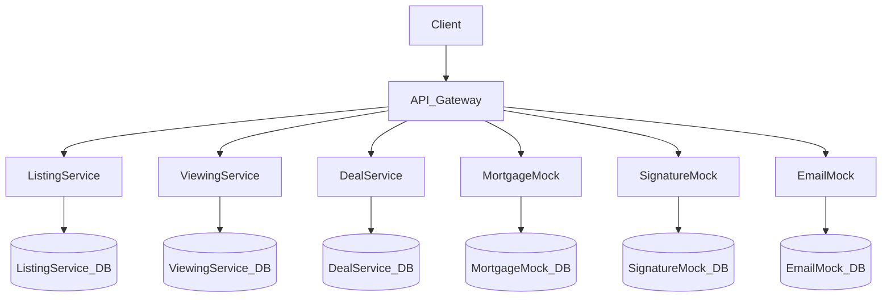

# Architecture

## Overview

realestate is a microservice-based application built with NestJS and TypeScript.

## System Overview

| Property | Value |
|----------|-------|
| Services | 6 |
| Entities | 12 |
| Database | PostgreSQL |
| Framework | NestJS |
| Language | TypeScript |
| Architecture | Modular Architecture |

## Architecture Diagram



## Services

### ListingService

- **Port:** 8001
- **Directory:** `realestate_listing_service/`
- **Entities:** Listing, Neighbourhood, PriceChange
- **REST API:** Yes

### ViewingService

- **Port:** 8002
- **Directory:** `realestate_viewing_service/`
- **Entities:** Viewing
- **REST API:** Yes

### DealService

- **Port:** 8003
- **Directory:** `realestate_deal_service/`
- **Entities:** Contract, Offer
- **REST API:** Yes

### MortgageMock

- **Port:** 8090
- **Directory:** `realestate_mortgage_mock/`
- **Entities:** ApiKey, LenderAnswer
- **REST API:** Yes

### SignatureMock

- **Port:** 8091
- **Directory:** `realestate_signature_mock/`
- **Entities:** ApiKey, VendorEnvelope
- **REST API:** Yes

### EmailMock

- **Port:** 8092
- **Directory:** `realestate_email_mock/`
- **Entities:** ApiKey, Outbound
- **REST API:** Yes


## Database Schema

### Entity Relationships

```mermaid
erDiagram
    Neighbourhood {

        DateTime createdAt
        DateTime updatedAt
        UUID id PK
        String(120) name
        String(120) city
        Float latitude
        Float longitude
    }

    Listing {

        DateTime createdAt
        DateTime updatedAt
        UUID id PK
        String(200) title
        String(120) neighbourhoodName
        PropertyKind kind
        Money price
        Integer bedrooms
        Integer bathrooms
        Integer areaSqm
        ListingStatus status
        String(200) agentName
        DateTime? publishedAt
        Text summary
        String(120) city
        Float latitude
        Float longitude
        Email agentEmail
    }

    PriceChange {

        DateTime createdAt
        DateTime updatedAt
        UUID id PK
        UUID listingId
        Money oldPrice
        Money newPrice
    }

    Viewing {

        DateTime createdAt
        DateTime updatedAt
        UUID id PK
        DateTime startsAt
        DateTime endsAt
        String(200) listingTitle
        String(200) buyerName
        ViewingStatus status
        String(200) agentName
        String(500)? note
        UUID listingId
        Email buyerEmail
        Email agentEmail
        Boolean reminderSent
    }

    Offer {

        DateTime createdAt
        DateTime updatedAt
        UUID id PK
        String(200) listingTitle
        String(200) buyerName
        Money amount
        Financing financing
        OfferStatus status
        String(40)? lenderReference
        UUID listingId
        Email buyerEmail
        Email agentEmail
    }

    Contract {

        DateTime createdAt
        DateTime updatedAt
        UUID id PK
        String(200) listingTitle
        String(200) buyerName
        Money price
        ContractStatus status
        DateTime? signedAt
        String(40)? envelopeId
        UUID listingId
        UUID offerId
        Email buyerEmail
        Email agentEmail
    }

    LenderAnswer {

        DateTime createdAt
        DateTime updatedAt
        UUID id PK
        String(200) applicantName
        Money amount
        PreapprovalDecision decision
        String(40) reference
        String(120) idempotencyKey
        Email applicantEmail
    }

    ApiKey {

        DateTime createdAt
        DateTime updatedAt
        UUID id PK
        String(64) keyHash
        UUID ownerId
        Array<String> scopes
        Boolean isActive
        DateTime? expiresAt
        DateTime? lastUsedAt
    }

    VendorEnvelope {

        DateTime createdAt
        DateTime updatedAt
        UUID id PK
        String(200) signerName
        String(200) documentTitle
        EnvelopeStatus status
        DateTime? settledAt
        Text documentBody
        Email signerEmail
        String(40) envelopeId
        String(120) idempotencyKey
    }

    ApiKey {

        DateTime createdAt
        DateTime updatedAt
        UUID id PK
        String(64) keyHash
        UUID ownerId
        Array<String> scopes
        Boolean isActive
        DateTime? expiresAt
        DateTime? lastUsedAt
    }

    Outbound {

        DateTime createdAt
        DateTime updatedAt
        UUID id PK
        String(200) recipient
        String(200) subject
        String(2000) body
        DeliveryStatus status
        String(40) deliveryId
        String(120) idempotencyKey
    }

    ApiKey {

        DateTime createdAt
        DateTime updatedAt
        UUID id PK
        String(64) keyHash
        UUID ownerId
        Array<String> scopes
        Boolean isActive
        DateTime? expiresAt
        DateTime? lastUsedAt
    }

```

### Entity Details

#### Neighbourhood

| Field | Type | Optional | Description |
|-------|------|----------|-------------|
| `createdAt` | DateTime | No | Createdat |
| `updatedAt` | DateTime | No | Updatedat |
| `id` | UUID | No | Id |
| `name` | String(120) | No | Name |
| `city` | String(120) | No | City |
| `latitude` | Float | No | Latitude |
| `longitude` | Float | No | Longitude |

#### Listing

| Field | Type | Optional | Description |
|-------|------|----------|-------------|
| `createdAt` | DateTime | No | Createdat |
| `updatedAt` | DateTime | No | Updatedat |
| `id` | UUID | No | Id |
| `title` | String(200) | No | Title |
| `neighbourhoodName` | String(120) | No | Neighbourhoodname |
| `kind` | PropertyKind | No | Kind |
| `price` | Money | No | Price |
| `bedrooms` | Integer | No | Bedrooms |
| `bathrooms` | Integer | No | Bathrooms |
| `areaSqm` | Integer | No | Areasqm |
| `status` | ListingStatus | No | Status |
| `agentName` | String(200) | No | Agentname |
| `publishedAt` | DateTime? | Yes | Publishedat |
| `summary` | Text | No | Summary |
| `city` | String(120) | No | City |
| `latitude` | Float | No | Latitude |
| `longitude` | Float | No | Longitude |
| `agentEmail` | Email | No | Agentemail |

#### PriceChange

| Field | Type | Optional | Description |
|-------|------|----------|-------------|
| `createdAt` | DateTime | No | Createdat |
| `updatedAt` | DateTime | No | Updatedat |
| `id` | UUID | No | Id |
| `listingId` | UUID | No | Listingid |
| `oldPrice` | Money | No | Oldprice |
| `newPrice` | Money | No | Newprice |

#### Viewing

| Field | Type | Optional | Description |
|-------|------|----------|-------------|
| `createdAt` | DateTime | No | Createdat |
| `updatedAt` | DateTime | No | Updatedat |
| `id` | UUID | No | Id |
| `startsAt` | DateTime | No | Startsat |
| `endsAt` | DateTime | No | Endsat |
| `listingTitle` | String(200) | No | Listingtitle |
| `buyerName` | String(200) | No | Buyername |
| `status` | ViewingStatus | No | Status |
| `agentName` | String(200) | No | Agentname |
| `note` | String(500)? | Yes | Note |
| `listingId` | UUID | No | Listingid |
| `buyerEmail` | Email | No | Buyeremail |
| `agentEmail` | Email | No | Agentemail |
| `reminderSent` | Boolean | No | Remindersent |

#### Offer

| Field | Type | Optional | Description |
|-------|------|----------|-------------|
| `createdAt` | DateTime | No | Createdat |
| `updatedAt` | DateTime | No | Updatedat |
| `id` | UUID | No | Id |
| `listingTitle` | String(200) | No | Listingtitle |
| `buyerName` | String(200) | No | Buyername |
| `amount` | Money | No | Amount |
| `financing` | Financing | No | Financing |
| `status` | OfferStatus | No | Status |
| `lenderReference` | String(40)? | Yes | Lenderreference |
| `listingId` | UUID | No | Listingid |
| `buyerEmail` | Email | No | Buyeremail |
| `agentEmail` | Email | No | Agentemail |

#### Contract

| Field | Type | Optional | Description |
|-------|------|----------|-------------|
| `createdAt` | DateTime | No | Createdat |
| `updatedAt` | DateTime | No | Updatedat |
| `id` | UUID | No | Id |
| `listingTitle` | String(200) | No | Listingtitle |
| `buyerName` | String(200) | No | Buyername |
| `price` | Money | No | Price |
| `status` | ContractStatus | No | Status |
| `signedAt` | DateTime? | Yes | Signedat |
| `envelopeId` | String(40)? | Yes | Envelopeid |
| `listingId` | UUID | No | Listingid |
| `offerId` | UUID | No | Offerid |
| `buyerEmail` | Email | No | Buyeremail |
| `agentEmail` | Email | No | Agentemail |

#### LenderAnswer

| Field | Type | Optional | Description |
|-------|------|----------|-------------|
| `createdAt` | DateTime | No | Createdat |
| `updatedAt` | DateTime | No | Updatedat |
| `id` | UUID | No | Id |
| `applicantName` | String(200) | No | Applicantname |
| `amount` | Money | No | Amount |
| `decision` | PreapprovalDecision | No | Decision |
| `reference` | String(40) | No | Reference |
| `idempotencyKey` | String(120) | No | Idempotencykey |
| `applicantEmail` | Email | No | Applicantemail |

#### ApiKey

| Field | Type | Optional | Description |
|-------|------|----------|-------------|
| `createdAt` | DateTime | No | Createdat |
| `updatedAt` | DateTime | No | Updatedat |
| `id` | UUID | No | Id |
| `keyHash` | String(64) | No | Keyhash |
| `ownerId` | UUID | No | Ownerid |
| `scopes` | Array<String> | No | Scopes |
| `isActive` | Boolean | No | Isactive |
| `expiresAt` | DateTime? | Yes | Expiresat |
| `lastUsedAt` | DateTime? | Yes | Lastusedat |

#### VendorEnvelope

| Field | Type | Optional | Description |
|-------|------|----------|-------------|
| `createdAt` | DateTime | No | Createdat |
| `updatedAt` | DateTime | No | Updatedat |
| `id` | UUID | No | Id |
| `signerName` | String(200) | No | Signername |
| `documentTitle` | String(200) | No | Documenttitle |
| `status` | EnvelopeStatus | No | Status |
| `settledAt` | DateTime? | Yes | Settledat |
| `documentBody` | Text | No | Documentbody |
| `signerEmail` | Email | No | Signeremail |
| `envelopeId` | String(40) | No | Envelopeid |
| `idempotencyKey` | String(120) | No | Idempotencykey |

#### ApiKey

| Field | Type | Optional | Description |
|-------|------|----------|-------------|
| `createdAt` | DateTime | No | Createdat |
| `updatedAt` | DateTime | No | Updatedat |
| `id` | UUID | No | Id |
| `keyHash` | String(64) | No | Keyhash |
| `ownerId` | UUID | No | Ownerid |
| `scopes` | Array<String> | No | Scopes |
| `isActive` | Boolean | No | Isactive |
| `expiresAt` | DateTime? | Yes | Expiresat |
| `lastUsedAt` | DateTime? | Yes | Lastusedat |

#### Outbound

| Field | Type | Optional | Description |
|-------|------|----------|-------------|
| `createdAt` | DateTime | No | Createdat |
| `updatedAt` | DateTime | No | Updatedat |
| `id` | UUID | No | Id |
| `recipient` | String(200) | No | Recipient |
| `subject` | String(200) | No | Subject |
| `body` | String(2000) | No | Body |
| `status` | DeliveryStatus | No | Status |
| `deliveryId` | String(40) | No | Deliveryid |
| `idempotencyKey` | String(120) | No | Idempotencykey |

#### ApiKey

| Field | Type | Optional | Description |
|-------|------|----------|-------------|
| `createdAt` | DateTime | No | Createdat |
| `updatedAt` | DateTime | No | Updatedat |
| `id` | UUID | No | Id |
| `keyHash` | String(64) | No | Keyhash |
| `ownerId` | UUID | No | Ownerid |
| `scopes` | Array<String> | No | Scopes |
| `isActive` | Boolean | No | Isactive |
| `expiresAt` | DateTime? | Yes | Expiresat |
| `lastUsedAt` | DateTime? | Yes | Lastusedat |


## Infrastructure Components

| Component | Description |
|-----------|-------------|
| NestJS | TypeScript framework with modular architecture |
| MikroORM | Database ORM with migration support |
| Health Checks | `/live`, `/ready` and `/health` endpoints (liveness, dependency-gated readiness, per-dependency report) |
| Middleware | CORS, validation, error handling |
| Prometheus Metrics | `/metrics` endpoint for scraping |
| OpenTelemetry | Distributed tracing with OTLP export |
| Message Queue | Async event-driven communication |


---

*Generated by cruftfree-codegen-typescript*
